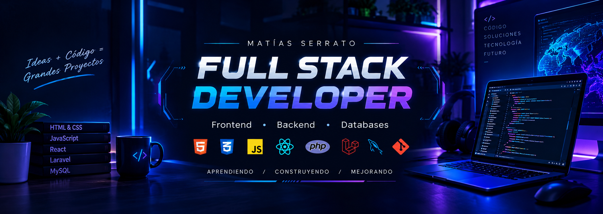

  

 

# ¡Hola! Soy Matías Serrato 👋

### Full Stack Developer en formación

Construyendo aplicaciones web, explorando nuevas tecnologías y desarrollando soluciones mediante proyectos prácticos.

---

## 👨‍💻 Sobre mí

- 💻 Enfocado en el desarrollo web Full Stack.
- 🌱 Fortaleciendo mis habilidades en frontend, backend y bases de datos.
- 🧩 Aprendiendo mediante el desarrollo de proyectos funcionales.
- 🤖 Interesado en la inteligencia artificial y su aplicación en el desarrollo de software.
- 🎯 Mi objetivo es crear aplicaciones útiles, mantenibles y bien documentadas.

---

## 🛠️ Tecnologías y herramientas

### 🎨 Frontend

### ⚙️ Backend y lenguajes

### 🗄️ Bases de datos

### 🤖 Inteligencia artificial

Interés en la inteligencia artificial, las herramientas de IA y su aplicación para desarrollar soluciones de software.

### 🔧 Herramientas y control de versiones

---

## 🚀 Proyectos destacados

### 📚 BiblioSENA

Proyecto de biblioteca en desarrollo.

- **Objetivo:** desarrollar una solución web para gestionar información de una biblioteca.
- **Tecnologías:** se especificarán según la implementación real.
- **Repositorio:** [Explorar mis repositorios](https://github.com/matiasserrato156-dotcom?tab=repositories)

### 🌐 Otros proyectos

Desarrollo de páginas web y aplicaciones como parte de mi formación práctica.

Puedes consultar mis repositorios para conocer mis proyectos y su evolución.

---

## 📈 Mi forma de trabajar

- 🧩 Organizo el código para facilitar su lectura y mantenimiento.
- 📘 Documento los pasos necesarios para ejecutar mis proyectos.
- 🧪 Desarrollo y pruebo funcionalidades progresivamente.
- 🚀 Busco mejorar la estructura, la experiencia de usuario y la calidad del software.
- 📚 Mantengo una actitud de aprendizaje y mejora continua.

---

## 📫 Contacto

- **GitHub:** [@matiasserrato156-dotcom](https://github.com/matiasserrato156-dotcom)

---

*Aprendiendo, construyendo y mejorando un proyecto a la vez.* 🚀

